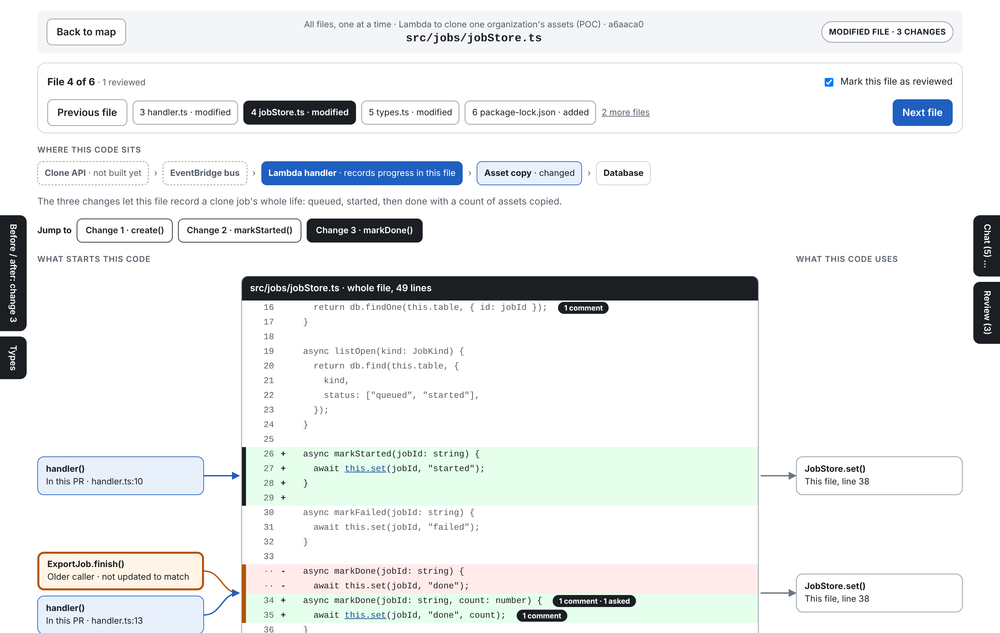
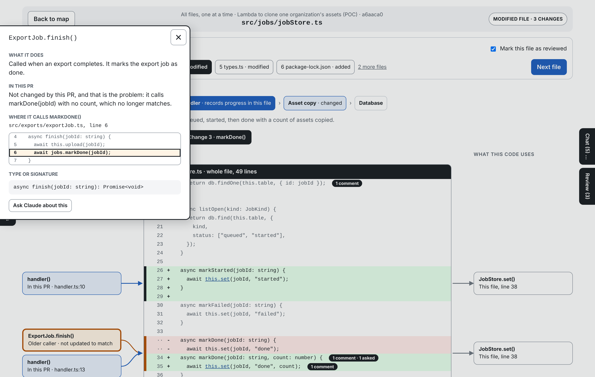
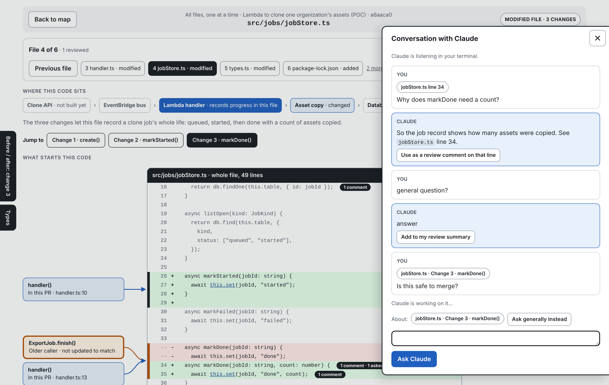
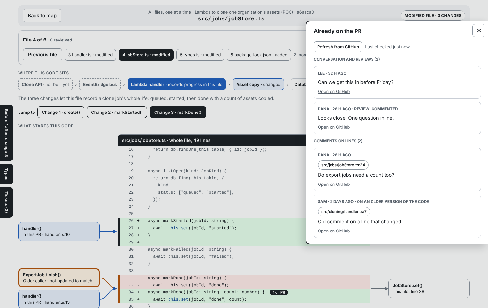
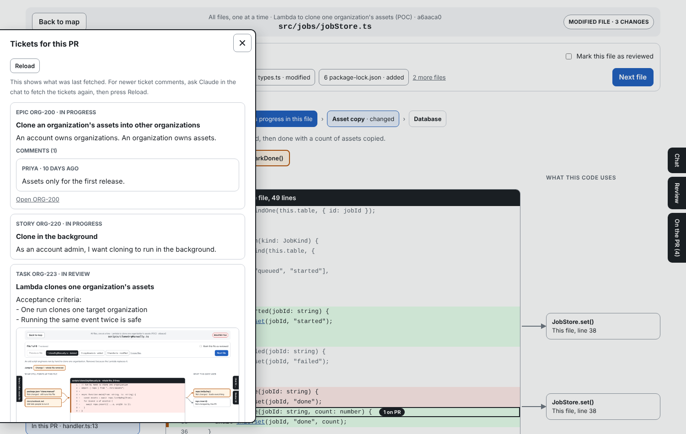

# review-code-in-context

A Claude Code skill for reviewing a pull request in your browser, one file at a time, with each change shown inside its whole file and the code around it explained.

You run one command in your terminal on a checked-out PR branch. Claude reads the diff and the surrounding repository, then opens a local page where you can:

- see every added, modified and deleted file, with the changes in place in the full file;
- see what calls each change and what each change uses, with lines drawn to the change;
- read a plain-language "before and after" for each change and for each file;
- click any line, card or flagged change and ask Claude about it, without retyping where you are;
- read the comments already on the PR and the linked tickets (epic, story, task) with their attachments;
- write your own line comments and submit them to GitHub as a comment, a request for changes, or an approval.



> **Status: early.** The page and helper are tested end to end against a small sample repository with stand-ins for GitHub and Jira. They have not yet been run against real GitHub or Jira, or on Windows or macOS. Expect rough edges and please report them.

## Contents

- [Requirements](#requirements)
- [Install](#install)
- [Quick start](#quick-start)
- [The review page](#the-review-page)
- [Asking Claude](#asking-claude)
- [Writing and submitting your review](#writing-and-submitting-your-review)
- [Comments already on the PR](#comments-already-on-the-pr)
- [Tickets](#tickets)
- [Pausing, and the automatic pause](#pausing-and-the-automatic-pause)
- [Resuming a review](#resuming-a-review)
- [Where your data is kept](#where-your-data-is-kept)
- [Limits](#limits)
- [Troubleshooting](#troubleshooting)
- [Helper commands](#helper-commands)

## Requirements

| Needed | Why |
| --- | --- |
| [Claude Code](https://code.claude.com/docs/en/overview) | Runs the skill and answers your questions. |
| Node.js 18 or newer | Runs the helper and the local page. No packages to install. |
| git | Reads the diff. |
| [GitHub CLI](https://cli.github.com/) (`gh`), signed in | Optional. Needed to find the PR, read its comments and post your review. Without it the review still works and your comments are saved to a file. |
| A way to read your tracker | Optional. See [Tickets](#tickets). |

## Install

Clone this repository into your Claude Code skills folder:

```
git clone https://github.com/kchang4/review-in-context ~/.claude/skills/review-code-in-context
```

To make it available to everyone on a project instead, clone it into that repository's `.claude/skills/` folder.

Update with `git pull` inside that folder. Remove it by deleting the folder. Saved reviews live elsewhere (see [Where your data is kept](#where-your-data-is-kept)) and are not touched by either.

## Quick start

1. Check out the PR branch you want to review:
   ```
   gh pr checkout 318
   ```
2. Start Claude Code in that repository and run:
   ```
   /review-code-in-context
   ```
   To compare against a base other than the PR's own, pass it: `/review-code-in-context origin/release`.
3. The first time in a repository, Claude checks your GitHub sign-in and asks what you use to track tasks. It never asks for a password or token.
4. Claude analyses the PR. This is the slow part: it reads every changed file and searches the repository for callers and uses. A small PR takes a few minutes.
5. Your browser opens on the first changed file. Leave the terminal open: Claude is listening there for your questions.
6. Work through the files, ask questions, write comments, and submit from the **Review** tab.

## The review page

**Files.** The bar at the top shows which file you are on ("File 4 of 17"), with Previous and Next, and a tick box to mark a file reviewed. **Back to map** lists every file with its status, number of changes, flags and your comments. Lock files, generated files and binaries are listed but not shown.

**The file.** The whole file is in the middle and scrolls. Added lines are green, removed lines are red, unchanged lines are grey.

**What starts this code / what this code uses.** Cards on the left show what calls each change. Cards on the right show what the change depends on. They hide while you scroll and come back lined up with every change in view. For a deleted file, the left side shows what still points at it.

- Blue cards are also changed in this PR.
- Orange cards need your attention: for example a caller that was not updated to match a changed function.
- Dashed cards are outside the repository or not built yet.
- "None found" means Claude looked and found nothing.

**Jump to.** One button per change. Clicking one selects that change and scrolls to it. Scrolling by hand clears the selection.

**Left-edge tabs.**

- **Before / after** describes the selected change, or the whole file when nothing is selected.
- **Types** shows the type definitions the file relies on.
- **Tickets** shows the linked epic, story and task.

**Details.** Click a card, or any underlined name in the code, to open a panel with what it does, how this PR relates to it, the actual lines where it is called or defined, and its signature.



### Dark mode

The page follows your system's light or dark setting. The **Dark mode / Light mode** button at the top right switches it, and the choice is remembered in that browser.

## Asking Claude

Click a line number, a card, or a flagged change and choose **Ask Claude**. Your question is sent with the file, the line and the surrounding code, so "why is this here?" is enough.

Claude answers from your terminal session, with the whole repository available. The full conversation is in the **Chat** tab on the right, and each question links back to the place you asked it from.



You ask one question at a time: while Claude is working, the message box is locked and a "Claude is working on your question" line sits just above it. Answers are formatted (lists, code blocks, tables), the conversation scrolls, and the message box stays at the bottom. Ctrl+Enter sends.

Claude can only answer while it is listening. The Chat tab tells you when it is not; if so, go to the terminal and tell it to continue the review.

## Writing and submitting your review

Click a line number, type your comment, and choose **Save as review comment**. Nothing is posted yet. A Claude answer can be turned into a comment with one click.

The **Review** tab lists your draft comments. Add an overall comment if you want, choose **Comment only**, **Request changes** or **Approve**, and press **Submit review**. You are shown exactly what will be posted and asked to confirm.

- Claude never posts, approves or requests changes on its own. Only your Submit does.
- GitHub accepts line comments only on changed lines and a few lines around them. A comment anywhere else is added to the review summary with its file and line, and the page tells you so when you write it.
- With no GitHub PR or no `gh`, Submit saves the review to a file and tells you where.

## Comments already on the PR

Everything already said on the PR is loaded when the review starts: the conversation, review summaries and line comments, whoever wrote them. Claude reads them during its analysis and is told what was already said on a line when you ask about it.

In the page they appear as an "on PR" badge on their line, inside the panel for that line, and all together in the **On the PR** tab, which has a **Refresh from GitHub** button.



## Tickets

If the branch name, PR title or PR description names a ticket, Claude follows it from the engineering task up to its story and epic and reads each one's description, comments and attachments. Images are shown in the **Tickets** tab, and Claude opens them itself to look at designs and screenshots.



There are two ways to give it access:

**Jira, directly.** Set these in your shell profile, then restart the terminal:

```
export JIRA_BASE_URL="https://yourcompany.atlassian.net"
export JIRA_EMAIL="you@yourcompany.com"
export JIRA_API_TOKEN="…"   # create one in your Atlassian account settings
```

Set them yourself. Do not paste a token into the chat.

**Anything else.** If Claude Code already has a way to read your tracker, such as an MCP server or a signed-in command-line tool, the skill uses that for Jira, Linear, GitHub issues or anything similar.

With neither, the review works without ticket context.

Tickets are stored once and shared: two reviews under the same epic read the same copy. Claude fetches the chain again at the start of every review and every resume, and a copy older than 30 minutes is marked stale.

## Pausing, and the automatic pause

While the page is open, Claude in the terminal wakes up every few minutes to check for your questions. Each wake-up costs a small amount (roughly a cent on a normal PR), so the page lets you stop that when you step away.

- **Pause session** (top right of every page) stops Claude listening straight away. Your comments, conversation and reviewed ticks are kept. Nothing is posted to the PR.
- **Automatic pause.** After 30 minutes with no mouse, keyboard or scroll activity on the page, a "Still reviewing?" box appears with a 2-minute countdown. Click **Keep reviewing** to carry on. If nobody answers, or the tab was closed, the session pauses itself.
- Either way, the page then shows the command to continue: `/review-code-in-context --resume`. You can keep reading the page while paused, but questions and new comments wait until you resume.

To change the 30 minutes for a repository, run `node ~/.claude/skills/review-code-in-context/rcc.mjs config set idleMinutes 60` inside it. `0` switches the automatic pause off.

## Resuming a review

Reviews survive a closed terminal, a restart, or a lost connection.

```
/review-code-in-context --resume
```

If there is one unfinished review for the repository, it reopens. If there are several, you get a list showing when each was started and last used, the branch and PR, and how far you got. Your reviewed ticks, draft comments and conversation are all restored, and any question that was never answered is answered now.

If the branch has new commits since the review started, you are warned: the page still shows the old commit, and you should start a new review to see the new ones.

## Where your data is kept

Nothing is written into your repository. Everything is under your home folder:

```
~/.review-code-in-context/
  config.json            setup answers, per repository
  sessions/<id>/         one review of one PR at one commit:
                         the diff, Claude's analysis, your ticks,
                         draft comments and conversation
  tickets/<KEY>/         one folder per ticket, with its attachments,
                         shared by every review that links it
```

This holds source code, ticket text and attachments, unencrypted. Delete a session folder to remove a review, or the whole folder to remove everything.

The review page is served only on your own machine (`127.0.0.1`) and is protected by a random token. No credentials are stored.

## Limits

- **The analysis is Claude's reading of your code.** Caller and usage tracing is only as good as the search. Treat an orange flag as something to check, not a verdict, and "None found" as "not found", not "none exist".
- **One commit per review.** New commits need a new review. Uncommitted changes are not shown.
- **PR threads are shown flat.** Replies are not grouped, resolved threads are not marked, and you cannot reply inside an existing thread.
- **Only the task, story and epic chain is fetched.** Sibling tickets are not. Older Jira projects that link stories to epics through the separate "Epic Link" field may not show the epic.
- **Posting back is GitHub only.**
- **No syntax colouring.** Files over 8,000 lines are skipped. Ticket attachments over 20 MB are not downloaded. Images pasted into GitHub comments appear as links.

## Troubleshooting

| What you see | What to do |
| --- | --- |
| `/review-code-in-context` is not offered | Check the folder is at `~/.claude/skills/review-code-in-context/` with `SKILL.md` directly inside it, then restart Claude Code. |
| "No GitHub PR found for this branch" | Run `gh auth status`, and check the branch has an open PR. The review still works without one. |
| Chat says Claude is not listening | In the terminal, tell Claude to continue the review. |
| A banner says the review server has stopped | Run `/review-code-in-context --resume`. |
| GitHub did not accept the review | The error is shown in the Review tab. You cannot approve or request changes on your own PR; use Comment only. |
| Jira answered 401 or 404 | Check the three `JIRA_` variables and that you can open the ticket in a browser. |
| The page shows old code | The branch moved after the review started. Start a new review. |

## Helper commands

Claude runs these for you; they are listed for debugging. Run them from the repository as `node ~/.claude/skills/review-code-in-context/rcc.mjs <command>`.

| Command | What it does |
| --- | --- |
| `skeleton [base]` | Starts a session and lists the changed files and changes. Uses the PR's own base when there is a PR (`--force-base` to override). |
| `build` | Merges Claude's analysis with the diff and reports mistakes in it. If the page is open, it updates in place. |
| `start` | Starts the local page and opens the browser. |
| `wait [seconds]` / `reply <id>` | How Claude receives and answers your questions. |
| `comments` | Fetches and prints what is on the PR. |
| `jira <KEY>` / `tickets` | Fetches and prints the linked tickets. |
| `sessions` / `resume [id]` | Lists and reopens saved reviews. |
| `history` | Prints the saved conversation, draft comments and reviewed files of the current session. |
| `status` / `stop` | Shows or stops the local page. |

Add `--session <id>` to any of them to target a specific review.

## Files in this repository

- `SKILL.md`: the instructions Claude follows.
- `rcc.mjs`: the helper that reads the diff, serves the page and keeps sessions.
- `viewer.html`: the review page.
